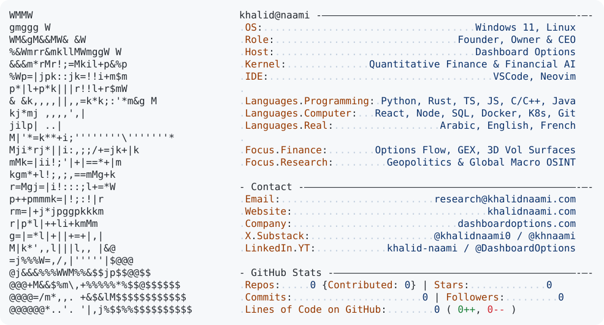

  <a href="https://github.com/khalid-naami/khalid-naami">
    <picture>
      <source media="(prefers-color-scheme: dark)" srcset="https://raw.githubusercontent.com/khalid-naami/khalid-naami/main/dark_mode.svg">
      
    </picture>
  </a>

---

## ✍️ Latest Blog Posts

<h3 align="center">Financial Intelligence · Market Research</h3>

<table align="center">
  <tr>
    <th>📄 Article</th>
    <th>📅 Published</th>
  </tr>
  <tr>
    <td>
      <a href="https://khalidnaami.com/blog/dashboard-options-finance-quantitative-edge">
        🚀 Dashboard Options for Finance: The Quantitative Edge
      </a>
    </td>
    <td>Jun 4, 2026</td>
  </tr>
  <tr>
    <td>
      <a href="https://khalidnaami.com/blog/my-trading-principles-wall-street-casino-my-story">
        🎰 My Trading Principles: Wall Street Casino — My Story
      </a>
    </td>
    <td>Jun 4, 2026</td>
  </tr>
  <tr>
    <td>
      <a href="https://khalidnaami.com/blog/market-dynamics-efficiency-momentum-mean-reversion">
        📈 Market Dynamics: Efficiency, Momentum & Mean Reversion
      </a>
    </td>
    <td>May 13, 2026</td>
  </tr>
  <tr>
    <td>
      <a href="https://khalidnaami.com/blog/guide-to-reading-daily-analysis">
        🧭 A Strategic Guide to Reading My Daily Analysis
      </a>
    </td>
    <td>May 13, 2026</td>
  </tr>
</table>

  

