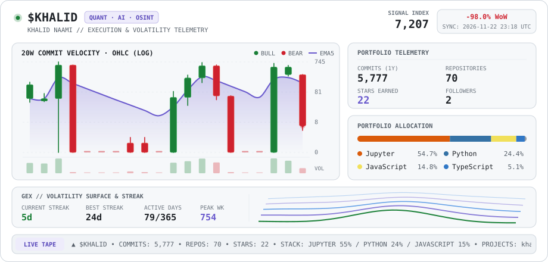

<h1 align="center">
  
</h1>

  
  
  

  ⚠️ <i><b>Notice:</b> The <b>Dashboard Options</b> project has been discontinued due to server costs and lack of an investor/funding.</i>

  

  

---

## 🏢 About Me & Dashboard Options

**Founder of the Dashboard Options project** — a professional-grade quantitative analytics platform that strips away market noise and reveals **real-time institutional options flow**.

⚠️ **Notice:** *The **Dashboard Options** project has been discontinued due to server costs and lack of an investor/funding.*

> *"The market is a machine for turning noise into signal — if you have the right decoder."* — Khalid Naami

- 🔭 Building **Dashboard Options** — GEX tracking, 3D volatility surfaces & institutional flow data
- 📊 Expert in **Quantitative Finance**, **Options Greeks**, and **Financial AI systems**
- 🌍 Strategic analyst specializing in **Geopolitics** and **Global Macroeconomics** (OSINT)
- 💬 Ask me about **Python, JavaScript, Options Data, Market Microstructure, Rust, React**
- 🌐 Personal site: **[khalidnaami.com](https://khalidnaami.com)**
- 📫 Reach me: **khalidnaami66@gmail.com**
- 🗣️ Languages: **Arabic · English · French**
- 🎓 Education: **Business Administration · Software Engineering · Data Analysis**

---

## ✍️ Latest Blog Posts

<h3 align="center">Financial Intelligence · Market Research</h3>

<table align="center">
  <tr>
    <th>📄 Article</th>
    <th>📅 Published</th>
  </tr>
  <tr>
    <td>
      <a href="https://khalidnaami.com/blog/dashboard-options-finance-quantitative-edge">
        🚀 Dashboard Options for Finance: The Quantitative Edge
      </a>
    </td>
    <td>Jun 4, 2026</td>
  </tr>
  <tr>
    <td>
      <a href="https://khalidnaami.com/blog/my-trading-principles-wall-street-casino-my-story">
        🎰 My Trading Principles: Wall Street Casino — My Story
      </a>
    </td>
    <td>Jun 4, 2026</td>
  </tr>
  <tr>
    <td>
      <a href="https://khalidnaami.com/blog/market-dynamics-efficiency-momentum-mean-reversion">
        📈 Market Dynamics: Efficiency, Momentum & Mean Reversion
      </a>
    </td>
    <td>May 13, 2026</td>
  </tr>
  <tr>
    <td>
      <a href="https://khalidnaami.com/blog/guide-to-reading-daily-analysis">
        🧭 A Strategic Guide to Reading My Daily Analysis
      </a>
    </td>
    <td>May 13, 2026</td>
  </tr>
</table>

  

---

## 🛠️ Languages & Tools

<h4 align="center">🐍 Python & Ecosystem</h4>

  
  
  
  
  
  

<h4 align="center">🤖 Machine Learning & AI (Python)</h4>

  
  
  
  

<h4 align="center">🟨 JavaScript / TypeScript & Web</h4>

  
  
  
  
  
  
  
  
  
  
  
  
  

<h4 align="center">⚙️ Systems, JVM & Mobile</h4>

  
  
  

<h4 align="center">🗄️ Databases & DevOps</h4>

  
  
  
  

---

## 📊 GitHub Statistics

  <a href="https://github.com/khalid-naami/khalid-naami">
    <picture>
      <source media="(prefers-color-scheme: dark)" srcset="https://raw.githubusercontent.com/khalid-naami/khalid-naami/main/quant_dark.svg">
      
    </picture>
  </a>

---

  <b>🚀 Building an open-source financial intelligence legacy, one commit at a time.</b>

  ⭐ <b>If you find my work useful, consider giving it a star!</b> ⭐

